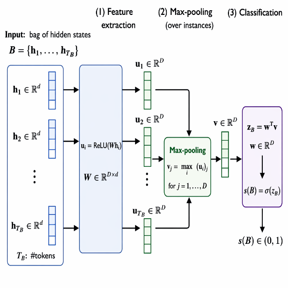

# Hallucination Detection Pipeline

<p align="center">
  
</p>

This repository contains research code for training a hallucination detection model using answers generated by large language models and their correctness judgments.
The `gen/` directory handles answer generation and evaluation, the `Detection/` directory trains the final classifier, and `longfact_pp/` runs the long-form experiment on LongFact++ (Section 6.3).

## 1. Setup

1. Prepare a Python 3.10+ environment and install dependencies.
   ```bash
   pip install -r requirements.txt
   ```
   Main libraries: `torch`, `transformers`, `datasets`, `openai`, `tenacity`, `python-dotenv`, `numpy`, `tqdm`, `scikit-learn`, `pandas`, `pyarrow`, `huggingface_hub`
2. Copy `.env.example` to `.env` and set tokens/endpoints.
   ```bash
   cp .env.example .env
   ```
   - `OPENAI_API_KEY` / `AZURE_OPENAI_API_KEY`: API key for the LLM used in evaluation
   - `AZURE_OPENAI_ENDPOINT`: Endpoint when using Azure OpenAI
   - `HUGGINGFACE_HUB_TOKEN`: Set only if required for downloading Hugging Face models
   - `HF_HOME`: Defaults to `~/.cache/huggingface` if omitted
   - For BioASQ, set `BIOASQ_TRAIN_PATH` to your local JSON path
3. Ensure the Hugging Face cache directory (`HF_HOME`) and the `Data/` directory are writable.

## 2. Data Layout

```
Hallucination_Detection/
├── Data/
│   └── <MODEL_NAME>/<DATA_NAME>/  # Artifacts generated by job1-3 (and longfact_pp/)
├── Detection/                     # Hallucination detection model
├── gen/                           # Generation and evaluation scripts
└── longfact_pp/                   # LongFact++ long-form experiment
```

- `job1` outputs `.pkl` and `.jsonl` files under `Data/<MODEL_NAME>/<DATA_NAME>/`.
- Subsequent jobs read from the same directory.

## 3. Pipeline Execution (job1 -> job4)


1. **job1: Generation (`gen/job1.sh`)**
   - Runs `gen/generation/generate_answers.py` and generates `r=5` answers per sample for the selected model and dataset.
   - Saves per-layer hidden-state pickle files (`*_layer*.pkl`) and QA JSONL (`qa_*.jsonl`).
   - Example:
   ```bash
   MODEL_NAME=llama3_70b DATA_NAME=nq \
   bash gen/job1.sh
   ```

2. **job2: Correctness Scoring (`gen/job2.sh`)**
   - `gen/generation/eval_correctness.py` uses an LLM (e.g., Azure OpenAI) to judge correctness of each generated answer and writes to `acc_*.jsonl`.
   - Example:
   ```bash
   MODEL_NAME=llama3_70b DATA_NAME=nq EVAL_MODEL=gpt-5-mini \
   bash gen/job2.sh
   ```

3. **job3: Entailment Clustering (`gen/job3.sh`)**
   - `gen/generation/compute_entailment.py` evaluates entailment relations among generated answers and stores cluster/entropy metrics in `se_*.jsonl`.
   - On first use, it creates API cache files (`entailment_cache_*.pkl`).
   - Example:
   ```bash
   MODEL_NAME=llama3_70b DATA_NAME=nq \
   bash gen/job3.sh
   ```

4. **job4: Detector Training (`Detection/job4.sh`)**
   - Runs `Detection/main.py` to train the hallucination detector on the stored hidden states.
   - Trains one detector per stored layer (`--layers` restricts the search), keeps the checkpoint with the best validation AUC, and reports the test AUC of the layer with the best validation AUC.
   - Saves checkpoints and `<data>_<pooling>_s<seed>_summary.json` under `results/<MODEL_NAME>/`.
   - Example:
   ```bash
   MODEL_NAME=llama3_8b DATA_NAME=trivia_qa SAVE_DIR=./results \
   bash Detection/job4.sh
   ```

The job scripts can be called from any directory; paths are resolved relative to the repository root:

```bash
bash gen/job1.sh
bash gen/job2.sh
bash gen/job3.sh
bash Detection/job4.sh
```

## 4. LongFact++ (`longfact_pp/`)

Uses the Hugging Face dataset `obalcells/longfact-augmented-annotations`. No API key is needed; a Hugging Face token with access to the Llama models is required. `MODEL_NAME` is `llama3_8b_Instruct` or `llama3_70b`.

All steps at once:
```bash
MODEL_NAME=llama3_8b_Instruct bash longfact_pp/job_lfpp.sh
MODEL_NAME=llama3_70b         bash longfact_pp/job_lfpp.sh
```

Step by step (8B example; for the 70B model use `--layers $(seq -s, 0 4 80)` in step 2):

1. **Build the splits** (`Data/<MODEL_NAME>/longfact_pp/`)
   ```bash
   python longfact_pp/build_cells.py --model_name llama3_8b_Instruct --data_dir Data
   ```
2. **Extract hidden states** (`{train,validation}_layer<L/2>.pkl`)
   ```bash
   python longfact_pp/extract_hidden.py --model_name llama3_8b_Instruct --data_dir Data --layers $(seq -s, 0 2 32)
   ```
3. **Train the detectors** (`--layers` takes stored-file indices, i.e. layer / 2; `--fixed_split` uses the fixed validation/test splits)
   ```bash
   python Detection/main.py --data_dir Data/llama3_8b_Instruct --model_name llama3_8b_Instruct \
     --data_name longfact_pp --test_data_list '["longfact_pp"]' --fixed_split \
     --layers $(seq -s, 0 1 16) --seed 42 --epoch 100 --batch_size 128 --reduced_dim 256 \
     --pooling_method max --save_dir results/longfact_pp
   ```
4. **Summarize** (test AUC at the validation-selected layer, mean over seeds)
   ```bash
   python longfact_pp/summarize.py --save_dir results/longfact_pp --model_name llama3_8b_Instruct
   ```

Hidden states take about 21 GB of disk per layer for the 8B model and about twice that for the 70B model.
